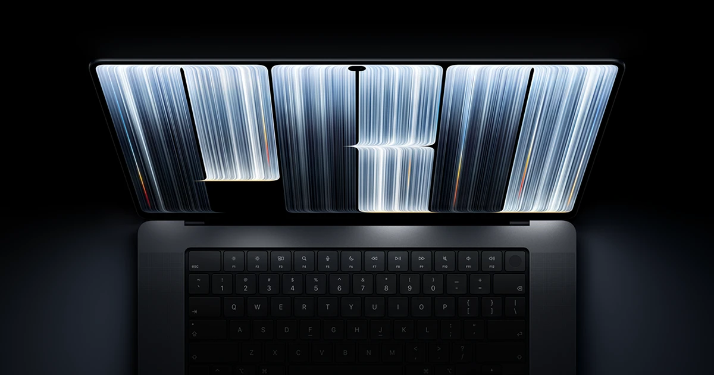
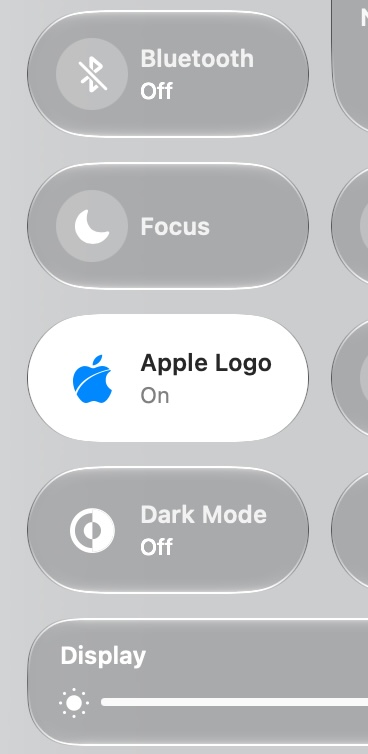
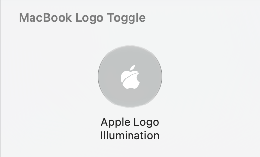

# MacBook Logo Toggle

A Control Center switch for the glowing Apple logo on the back of the MacBook Pro with PROLED XDR Display. macOS has no setting for it; this project adds an "Apple Logo Illumination" switch that looks and works like the built-in Wi-Fi and Bluetooth switches.



It uses the method from Apple's support article <https://support.apple.com/en-us/149248>:

- Off: `sudo defaults write com.apple.CoreBrightness LEBacklightMode -int 0`
- On (back to the default, following display brightness and ambient light): `sudo defaults delete com.apple.CoreBrightness LEBacklightMode`

The setting lives in root's defaults domain and applies to every user account, so switching it needs root. By default each switch asks for an administrator password; after installing the optional passwordless rule (see [Passwordless switching](#passwordless-switching)), one tap is enough.

## Requirements

- MacBook Pro with PROLED XDR Display
- macOS 26 or later
- Xcode, to build the Control Center extension (it is signed ad hoc, so no developer certificate is needed)
- An administrator account

## Install

1. Build and install the app into `~/Applications`:

   ```bash
   ./build.sh
   ```

2. Optional but recommended, so switching doesn't ask for a password every time (asks for your password once):

   ```bash
   sudo ./install-nopasswd.sh
   ```

3. Add the switch to Control Center (see below).

## Add it to Control Center

This step has to be done by hand: Control Center keeps its controls in a system database with no command-line or configuration-file interface.

1. Click Control Center in the menu bar, scroll to the bottom and click **Edit Controls**.
2. Search for **Apple Logo**, or pick **MacBook Logo Toggle** in the sidebar:

   

3. Drag **Apple Logo Illumination** into Control Center (or straight into the menu bar):

   

Tapping it then turns the logo light on or off. The switch shows **On** / **Off** and is highlighted when on, and a notification shows the result. Without the passwordless rule, an administrator prompt appears in between.

The extension runs in the App Sandbox, so it can't get root or read the real state of the light, and the app can't report back whether a switch worked. The switch therefore shows the last value set from Control Center. It can drift from the real state after switching from the command line or by opening the app directly, or when the administrator prompt is cancelled or the switch fails. Tapping it once more brings it back in line.

## Passwordless switching

```bash
sudo ./install-nopasswd.sh
```

It:

1. installs `logo-light.sh` as `/usr/local/libexec/logo-light`, owned by root so normal users can't change it;
2. writes `/etc/sudoers.d/logo-light`, which lets your account run it without a password, with `toggle` / `on` / `off` / `status` as the only allowed arguments;
3. refuses to install if the helper or any directory above it can be changed by anyone but root (including through symlinks or ACLs), and checks the rule with `visudo` before and after writing it, taking it back if a check fails.

Trade-off: any program running under your account can switch the logo light without a password, but it gets no other root access.

The passwordless path runs the copy in `/usr/local/libexec`, so after editing `logo-light.sh`, run `sudo ./install-nopasswd.sh` again.

To remove it (the app goes back to asking for a password):

```bash
sudo ./install-nopasswd.sh uninstall
```

## Command line

`./logo-light.sh` uses `sudo` internally, so it asks for your password, even for `status`:

```bash
./logo-light.sh status
```

```bash
./logo-light.sh toggle
```

With the passwordless rule installed, use the installed helper instead, which needs no password:

```bash
sudo /usr/local/libexec/logo-light status
```

```bash
sudo /usr/local/libexec/logo-light toggle
```

Both also accept `on` and `off`.

## Files

| File | Purpose |
| --- | --- |
| `logo-light.sh` | Core script: `status` / `on` / `off` / `toggle` (default `toggle`) |
| `MacBookLogoToggle.applescript` | App source. Opening the app toggles; opening `macbooklogotoggle://on` / `off` sets that state. Uses passwordless `sudo -n` when the rule is installed, the administrator prompt otherwise, then shows a notification |
| `install-nopasswd.sh` | Installs / uninstalls the root-owned helper and the sudoers rule that allows only it |
| `Control/` + `MacBookLogoToggle.xcodeproj` | The Control Center switch extension (WidgetKit), built and embedded into the app by `build.sh` |
| `logo.svg` | The black flat logo (classic apple with an arc cut from lower left to upper right, narrowing as it rises), the single source for the app icon and the Control Center symbol |
| `make-icon.swift` | Composes the app icon from `logo.svg` (run by `build.sh`) |
| `make-symbol.py` | Turns `logo.svg` into the custom SF Symbol `applelogo.cut` (run by `build.sh`; don't edit its output by hand) |
| `trace-logo.py` | One-off script that traced `logo.svg` from a reference image (needs Pillow; not part of the build) |
| `build.sh` | Builds the extension, icon and app, and installs `~/Applications/MacBook Logo Toggle.app` |

## Rebuild

After changing the scripts, the AppleScript, `logo.svg` or `Control/`, rebuild and reinstall (needs Xcode):

```bash
./build.sh
```

If the build fails, the installed app is left untouched.

Every build gets a new version number, which is what makes Control Center re-read the switch's name and description instead of showing a cached copy. macOS registers the reinstalled extension asynchronously, so Control Center can take a little while after the build to pick it up.

## Uninstall

First put the light back to its default (on):

```bash
./logo-light.sh on
```

If you installed the passwordless rule, remove it and the helper:

```bash
sudo ./install-nopasswd.sh uninstall
```

Remove **Apple Logo Illumination** from Control Center in Edit Controls, then delete the app:

```bash
rm -rf ~/Applications/"MacBook Logo Toggle.app"
```

Note: reinstalling macOS also turns the logo light back on.

## License

This project is licensed under the [GNU Affero General Public License v3.0](LICENSE). The license covers this project's own code and files; Apple's trademarks and the hero image remain Apple's.

## Disclaimer

Apple, the Apple logo and MacBook Pro are trademarks of Apple Inc. This project is not affiliated with or endorsed by Apple.
